<picture>
  <source media="(prefers-color-scheme: dark)" srcset="assets/banner-dark.svg">
  <source media="(prefers-color-scheme: light)" srcset="assets/banner-light.svg">
  
</picture>

<picture>
  <source media="(prefers-color-scheme: dark)" srcset="https://raw.githubusercontent.com/eandreaja/eandreaja/output/commit-invaders-dark.svg">
  <source media="(prefers-color-scheme: light)" srcset="https://raw.githubusercontent.com/eandreaja/eandreaja/output/commit-invaders.svg">
  
</picture>

### Open source

<picture>
  <source media="(prefers-color-scheme: dark)" srcset="assets/open-source-dark.svg">
  <source media="(prefers-color-scheme: light)" srcset="assets/open-source-light.svg">
  
</picture>

| Project | Contribution | Outcome |
| --- | --- | --- |
| [SoloMD](https://github.com/zhitongblog/solomd) | Added the Pure Black (OLED) Soft community theme — [#540](https://github.com/zhitongblog/solomd/pull/540) | Merged by the maintainer on 2026-11-12 |
| [SoloMD](https://github.com/zhitongblog/solomd) | Requested Spanish (Hunspell) dictionary support — [#246](https://github.com/zhitongblog/solomd/issues/246) | Fix verified, shipped in v4.14.0 |

### Certifications

<picture>
  <source media="(prefers-color-scheme: dark)" srcset="assets/certifications-dark.svg">
  <source media="(prefers-color-scheme: light)" srcset="assets/certifications-light.svg">
  
</picture>

| Certification | Issuer | Verify |
| --- | --- | --- |
| ONE - Certificado de Finalización del programa G10 (Oracle Next Education), 262 h | Alura | [Verification page](https://credsverse.com/credentials/f744202a-d825-460b-ac51-858e7c6304c1?preview=1) |
| Oracle Cloud Infrastructure Certified AI Foundations Associate | Oracle | [Verification page](https://catalog-education.oracle.com/ords/certview/sharebadge?id=3E8714C0B8401AC946B5DBD98885E5D075F65F9B28C2FE26C8A94F8D8123E768) |
| Programación para Machine Learning — Componente Completo, 328 h | Unión Temporal LinkTech (Estud-IA) | [Sparlum verification page](https://sparlum.ucaldas.edu.co/verificar/) (general page; the code is shared on request) |

### Hackathons

<picture>
  <source media="(prefers-color-scheme: dark)" srcset="assets/hackathons-dark.svg">
  <source media="(prefers-color-scheme: light)" srcset="assets/hackathons-light.svg">
  
</picture>

| Event | Project | Result |
| --- | --- | --- |
| No Country | [G10-LATAM-EQUIPO-16](https://github.com/No-Country-simulation/G10-LATAM-EQUIPO-16) — Aigoraweave, intelligent transformation and distribution engine for digital communities | 5th of 52 teams |
