<picture>
  <source media="(prefers-color-scheme: dark)" srcset="assets/banner-dark.svg">
  <source media="(prefers-color-scheme: light)" srcset="assets/banner-light.svg">
  
</picture>

<picture>
  <source media="(prefers-color-scheme: dark)" srcset="https://raw.githubusercontent.com/eandreaja/eandreaja/output/commit-invaders-dark.svg">
  <source media="(prefers-color-scheme: light)" srcset="https://raw.githubusercontent.com/eandreaja/eandreaja/output/commit-invaders.svg">
  
</picture>

### Open source

<picture>
  <source media="(prefers-color-scheme: dark)" srcset="assets/open-source-dark.svg">
  <source media="(prefers-color-scheme: light)" srcset="assets/open-source-light.svg">
  
</picture>

| Project | Contribution | Outcome |
| --- | --- | --- |
| [SoloMD](https://github.com/zhitongblog/solomd) | Requested Spanish (Hunspell) dictionary support — [#246](https://github.com/zhitongblog/solomd/issues/246) | Fix verified, shipped in v4.14.0 |
| [SoloMD](https://github.com/zhitongblog/solomd) | Reported a text-selection freeze in the Windows editor — [#374](https://github.com/zhitongblog/solomd/issues/374) | Fixes verified, shipped in v4.14.6 and v4.14.8 |
